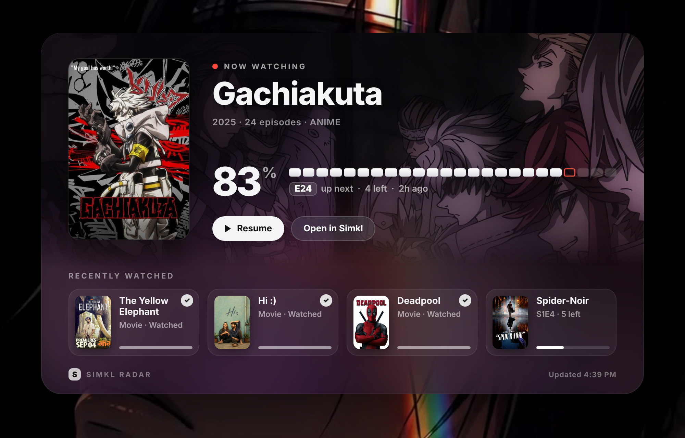

# Simkl Radar for Mac

Three ways to see what you're watching on a Mac. All of them read the same Simkl account.

| Where | How | Files |
| --- | --- | --- |
| **Desktop** (large widget) | [Übersicht](https://tracesof.net/uebersicht/) | `simkl/simkl-radar.widget/` |
| **Menu bar** | [SwiftBar](https://swiftbar.app) | `simkl/simkl.10m.js` |
| **Desktop or Notification Center, nothing running on the Mac** | `scriptable/Simkl Big.js` on the iPhone (large), shown on the Mac via "Use iPhone widgets" | nothing to install on the Mac |

## Install

1. Install the two free apps: `brew install --cask ubersicht swiftbar`
   (or download them from the links above). Open SwiftBar once and pick a plugin folder.
2. From this repo run: `bash mac/install.sh`
   It copies the shared core to `~/.simkl-radar/`, the widget into Übersicht, the plugin into SwiftBar,
   then opens Simkl to link your account. The code is copied to your clipboard; paste it and press **Connect**.

To re-link later: `osascript -l JavaScript ~/.simkl-radar/simkl.js login`

## Notification Center

macOS can show iPhone widgets. Open **System Settings → Desktop & Dock → Widgets** and turn on **Use iPhone widgets**.
Then click the date in the menu bar, choose **Edit Widgets**, search **Scriptable**, and add it. Pick the
*Simkl Radar* script, same as on the phone. Needs iOS 17+, the same Apple Account, and the iPhone nearby or on the same Wi-Fi.
This shows the iPhone widget as is; it is not a separate Mac build.

## How it works

- `simkl/simkl.js` is a JavaScript-for-Automation script, so it runs on any Mac with nothing extra installed.
  `login` does Simkl's PIN sign-in; `data` prints your recent watches as JSON. The token is stored in
  `~/.simkl-radar/token` (readable only by you). The last good result is cached, so when you're offline
  the widgets keep showing it with an "offline" tag.
- **Move the desktop widget** from the menu bar: Simkl icon → **Move desktop widget** → Top left / Top centre / Top right / Centre / Bottom left / Bottom right.
  Or from Terminal: `osascript -l JavaScript ~/.simkl-radar/simkl.js position top-right`.
  Dragging the bottom bar (⠿ drag) also works if Übersicht passes the mouse through; double-click it to undo a drag.
- The desktop widget refreshes every 10 minutes. Click **Resume**, the poster or any card to open the
  title in Nuvio; **Open in Simkl** opens the Simkl page. Change `WATCH_APP`, `ACCENT` or `POSITION` at the top of `index.jsx`.
- The menu bar plugin shows the current title and next episode; its dropdown has progress, poster thumbnails,
  and the last six items. Set `SHOW_TITLE = false` for an icon-only menu bar.

## Status

Built and previewed on Linux: the widget's real JSX was rendered in Chromium with real Simkl artwork
(`docs/`), and the menu bar output and data normalisation were unit-tested with the macOS calls stubbed.
None of it has run on a real Mac yet, so the first install is the real test.
