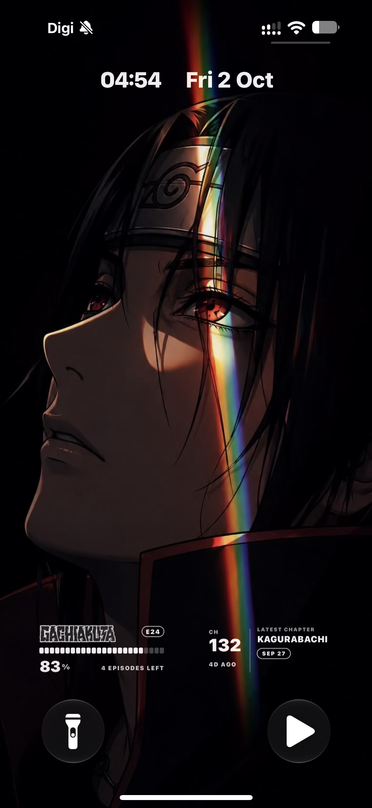

# Scriptable widgets

Home-screen and lock-screen widgets for [Scriptable](https://scriptable.app). Paste a script into Scriptable, name it as shown, then add a Scriptable widget and pick it under *Script*.

| Script (name in Scriptable) | Where | What |
| --- | --- | --- |
| `Simkl Radar.js` → **Simkl Radar** | Home, medium | Continue-watching card from Simkl. Run it once in-app to link your account (PIN flow); the token is stored in `simkl-token.txt`, which the other Simkl script reuses. |
| `Simkl Lock.js` → **Simkl Lock** | Lock screen, rectangular / circular / inline | Latest watched item with an episode tick bar (one tick per episode), `E24` pill, big percentage and episodes left. Optional official title logo from TMDB. |
| `Simkl Lock (big-number variant).js` | Lock screen | Alternate layout: big percentage on the left, title/sub-line/bar on the right. |
| `Manga Lock.js` → **Manga Lock** | Lock screen, rectangular / circular / inline | Kagurabachi from WeebCentral: big chapter number, age, unread pill + read bar (needs a public AniList list). `CIRCLE_STYLE` picks one of four minimal circles. |
| `Manga Small.js` → **Manga Small** | Home, small | Three-series manga roster (WeebCentral + AniList unread badges). |
| `Itachi Eyes.js` → **Itachi Eyes** | Lock screen, rectangular | Transparent Sharingan eyes (PNG embedded as base64). Source image: `itachi_eyes_transparent.png`. |

## Setup notes

- **Simkl Lock needs Simkl Radar linked first** (it reads the same `simkl-token.txt`).
- **TMDB logos (optional):** get a free v3 API key at themoviedb.org → Settings → API and paste it into `const TMDB_KEY = "";` at the top of `Simkl Lock.js`. The key is intentionally blank in this repo; don't commit it. Leave it empty (or set `USE_LOGOS = false`) for plain text titles.
- **Unread counts for manga** come from AniList. If your profile is private, the API answers "Private User" and the widgets fall back to the release date. Make the list public (AniList → Settings → Privacy) to get unread counts.
- Lock-screen widgets are single-tint: everything is white at different opacities, and dark artwork nearly disappears.
- Run any lock script inside Scriptable to get an enlarged preview (`PREVIEW = "rect" | "circle"`).

## Final result

`docs/final-lockscreen.png` is the finished lock screen: Simkl Lock (Gachiakuta with its TMDB logo, episode ticks, `E24` pill, 83%, 4 episodes left) on the left and Manga Lock (Kagurabachi, Ch 132, `SEP 27`) on the right.

## Design explorations

`docs/previews/` holds the mockups from the design pass (rectangle and small-slot options for both trackers). They are mockups, not screenshots of the real widgets.
